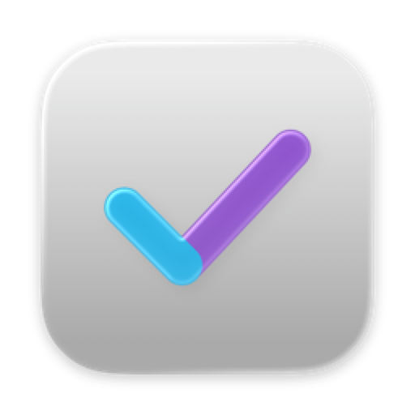
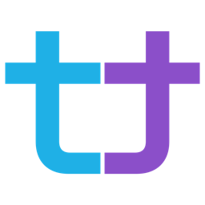

<p align="center">
  
</p>

<h1 align="center">TwoToned Projects</h1>

<p align="center">
  <strong>A native Mac project manager for people who build things.</strong><br>
  Tasks, bugs, and ideas for every project, a clear answer to "what am I working on?",<br>
  and lists that Claude Code can read and update while it works.
</p>

<p align="center">
  <a href="../../releases/latest"></a>
  
  
  <a href="LICENSE"></a>
</p>

---

## What it does

| | |
|---|---|
| **Projects at a glance** | Active, Paused, Released, and Archived projects in one sidebar, plus a *What's next* view across all of them. |
| **Lists your way** | Every project starts with Bugs, Tasks, and Ideas. Rename them, reorder them, or add your own. |
| **Up Next** | One combined list of everything open, ordered by priority with bugs first. Drag to reorder. The top item is your current task. |
| **Rich items** | Markdown notes, priority, due dates, tags, subtasks, links, file attachments, and bug details (steps, expected, actual, screenshot). |
| **Brainstorm** | Jot down project ideas as bullets, then turn one into a real project with every bullet waiting in its Ideas list. |
| **Menu bar** | *(optional)* See and check off your current task, or quick-add an item, without opening the app. |
| **Shortcuts** | *(optional)* Quick add or complete your current task from any app. All shortcuts start unassigned. |
| **Linked folders** | A gallery of the project's images, videos, and PDFs, its rendered README, code stats, and a list of what git ignores. |
| **Claude Code** | Claude can read your Up Next, log the bugs it finds, and check off what it finishes, all in the project it's working on. |
| **iCloud backups** | Numbered backups of a project's whole folder and lists to iCloud Drive, on demand or automatically. |

It's light on your Mac: everything is event-driven, so it uses almost no CPU while it waits in the background.

## Download

1. Download **TwoToned-Projects-0.5.zip** from the [latest release](../../releases/latest).
2. Double-click the zip, then drag **TwoToned Projects** into your **Applications** folder.
3. Open it. The first time, macOS will say it can't verify the app (see below), so click **Done**.
4. Open **System Settings › Privacy & Security**, scroll down to the message about TwoToned Projects, and click **Open Anyway**. Confirm with your password or Touch ID.

You only do this once. After that it opens like any other app.

> **Why the warning?** TwoToned Projects is free and open source, and isn't notarized by Apple (that needs a paid developer account). The app you download is built from exactly the code in this repository. If you'd rather not run a downloaded app, [build it yourself](#build-from-source); it takes about a minute.

**Requirements:** macOS 27 or later on Apple silicon.

## Documentation

- **[Getting started](docs/getting-started.md):** projects, lists, Up Next, the menu bar, and shortcuts
- **[Claude Code](docs/claude-code.md):** connect, use, and disconnect
- **[Backups](docs/backups.md):** iCloud Drive backups and what's inside them
- **[Uninstalling](docs/uninstalling.md):** how to remove the app without leaving anything behind

## Build from source

You'll need Xcode 27. No Apple Developer account is required: the project signs to run locally.

1. Clone this repository.
2. Open `TwoTonedProjects.xcodeproj`.
3. Choose the **TwoTonedProjects** scheme and press **Run** (⌘R).

Or from Terminal:

```bash
xcodebuild -project TwoTonedProjects.xcodeproj -scheme TwoTonedProjects -configuration Release -derivedDataPath build build
```

The app is created at `build/Build/Products/Release/TwoToned Projects.app`.

## Privacy

- Everything stays on your Mac, in the app's own storage. There's no account, no server, and no analytics.
- Linked project folders are only ever read, never written to.
- The Claude Code connection only works on your Mac. Claude can only see the project linked to the folder it's working in.
- Backups go only where you choose (iCloud Drive by default).
- **Settings › Data › Remove all TwoToned data** deletes everything the app has stored. See [Uninstalling](docs/uninstalling.md).

## Project layout

```
TwoTonedProjects/     The app (SwiftUI + SwiftData)
  App/                App entry, services, data store
  Models/             Projects, lists, items, activity, brainstorm ideas
  Logic/              Ordering rules, actions, export/import, cleanup
  Views/              Main window
  MenuBar/            Menu bar item, panels, quick add
  Shortcuts/          Global shortcuts and the shortcut recorder
  Folders/            Folder scanning, Files and Overview tabs
  Backups/            iCloud Drive backups
  Claude/             Claude Code bridge, tools, and connection
TwoTonedMCP/          The bundled Claude Code (MCP) helper
Design/               Icon layers and branding
docs/                 Documentation
```

## License

MIT. See [LICENSE](LICENSE).

---

<p align="center">
  <a href="https://www.twotonedstudios.com"></a><br>
  <sub>Made by <a href="https://www.twotonedstudios.com">TwoToned Studios</a></sub>
</p>
