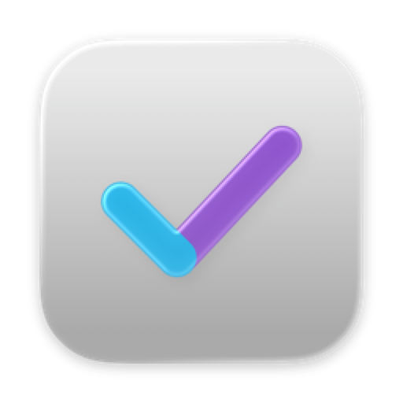

# Getting started

## Projects

Click **+** in the sidebar to create a project. Give it a name, a status, and a color. You can link its folder now or later. Every project starts with three lists: **Bugs**, **Tasks**, and **Ideas**.

Projects have four statuses, which group them in the sidebar:

| Status | Use it for |
|---|---|
| **Active** | What you're working on now |
| **Paused** | On hold for a while |
| **Released** | Basically done, but you may come back for updates or fixes |
| **Archived** | Finished and put away. Nothing is deleted. |

Right-click a project for its status, settings, a backup, a Markdown export, or delete. **Project settings** (the slider icon in the toolbar) has the name, color, icon, GitHub link, linked folders, lists, and backup options.

## Lists and items

Each list has its own tab. Type in the add field at the top and press Return. Some shortcuts work right in the field:

- `b: crash on launch` adds to the list whose name starts with "b" (Bugs).
- `!high` sets the priority (`!low`, `!medium`, `!high`, `!urgent`).

Click an item to open its details on the right: notes in Markdown, priority, due date, tags, subtasks, links, attachments, and, for bugs, steps to reproduce, expected and actual behavior, and a screenshot.

To change lists, open **Project settings › Lists**, where you can rename them, change their icons, reorder them, add new ones, or delete them. Each list has two switches:
- **Up Next** includes the list in Up Next. Ideas is off by default, so rough ideas don't crowd your work.
- **Bug fields** shows bug details on new items.

## Up Next

**Up Next** combines every open item from the lists that feed it, ordered by priority (urgent first), then list order (bugs first), then oldest first.

- **The top item is your current task**, marked *Now*.
- Drag items to reorder them. Your order is never re-sorted behind your back.
- **Re-sort by priority** at the bottom puts the default order back.
- Right-click an item for **Make current task**, **Move to**, **Priority**, or **Delete**.

Completed items go to the **Done** tab, grouped by day. Click a checkmark there to reopen an item. The **Activity** tab shows recent changes made by you or by Claude.

## What's next and Brainstorm

- **What's next** (top of the sidebar) shows each active project's current task, anything due soon, and high-priority bugs.
- **Brainstorm** is for ideas that aren't projects yet. Add a bullet, add details under it, and drag to reorder. When one is worth building, choose **Convert to project…**: you name it, and every bullet goes into the new project's Ideas list.

## Linked folders

Link a project's folder in **Project settings › Folders**. Two more tabs appear:

- **Files:** images, videos, PDFs, and docs from the folder, with Quick Look. **Git ignored** lists what git ignores.
- **Overview:** the folder's README, code stats (lines by language, file count, size), and buttons to open the folder in Finder, Terminal, VS Code, or Xcode.

The app only reads linked folders. It never writes to them.

## Menu bar and shortcuts

- **Menu bar** (Settings › General, off by default): shows your current task in the menu bar. Click it to check the task off, see the rest of Up Next, or add an item.
- **Shortcuts** (Settings › Shortcuts, all unassigned by default): quick add, complete current task, show the menu bar panel, or open the app, from any app. Click **Record shortcut** and press the keys you want.
- **Quick actions project** (Settings › General): the project the menu bar and shortcuts act on. You can also switch it from the menu bar panel.

## Your data

Everything is stored on your Mac. **Settings › Data** can export a full backup (JSON) and import one. A project can also be exported as Markdown from its right-click menu. For off-Mac copies, see [Backups](backups.md).
